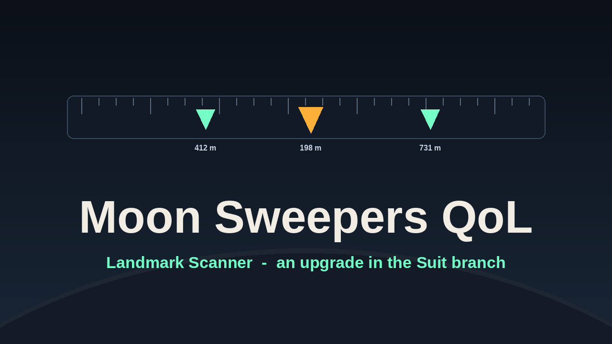

# Moon Sweepers QoL

Quality-of-life additions for Moon Sweepers, as one BepInEx plugin. Everything is sold
as an upgrade in the game's own upgrade tree, so it is earned, not handed out.

## Features

**Landmark Scanner** (Suit branch, needs Servo Stride) marks the landmark flags and lunar
sites you have not raised yet:

- on the compass, in the game's own style, with distance. The nearest one always shows,
  pinned to the edge when it is behind you.
- on the station hologram, and on the map screen opened from it, with the game's own
  hover panel and click handling.

Raised ones are left to the game, which already draws them.

**Belt Drive** (Logistics, needs Rapid Transfer) speeds up conveyor belts, up to +500%, so
they keep fast machines fed.

**Machine Overdrive** (Logistics, needs Belt Drive) speeds up stone presses and pressure
chambers, up to +250%. They draw proportionally more power, so energy per product stays the same.

**Robot Drive** (Cleaning, needs Long Reach) makes robot vacuums travel and clean faster, up to
+60%, on and off screen.

**Robot Heads** (Cleaning, needs Robot Drive) widens what they cover, up to +45%.

## Install

1. Install BepInEx for the game with [MoonSweepers BepInEx Patcher](https://www.nexusmods.com/moonsweepers/mods/9).
2. Extract the release zip over the game folder, or build it yourself:

```sh
dotnet build -t:Install
```

Close the game first. Set `MS_GAME_DIR` if it is not in the default Steam library.

`BepInEx/config/dodo.moonsweepers.qol.cfg` has `RequireUpgrade`; set it to `false` to
have everything on without buying it. `OverdrivePower` in the same file turns off the extra
power draw.

## Docs

- [Development and releasing](docs/development.md)
- [NOTES.md](NOTES.md): how it works and the traps that cost a day each.

## License

MIT, see [LICENSE](LICENSE).
